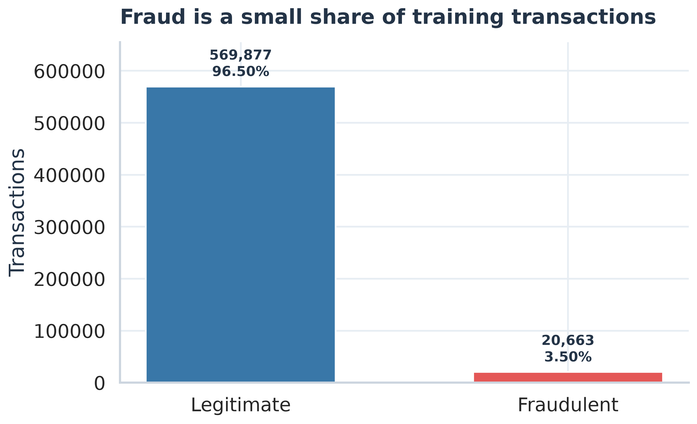
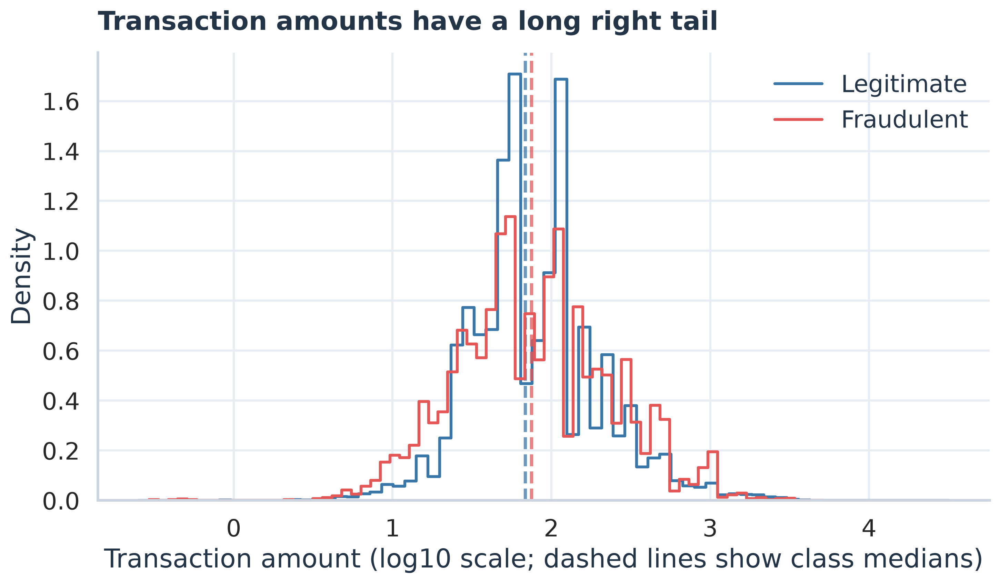
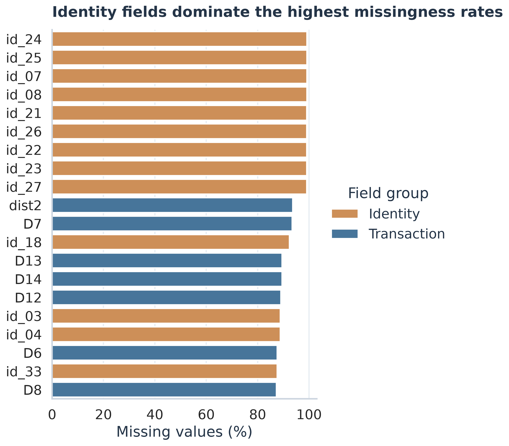
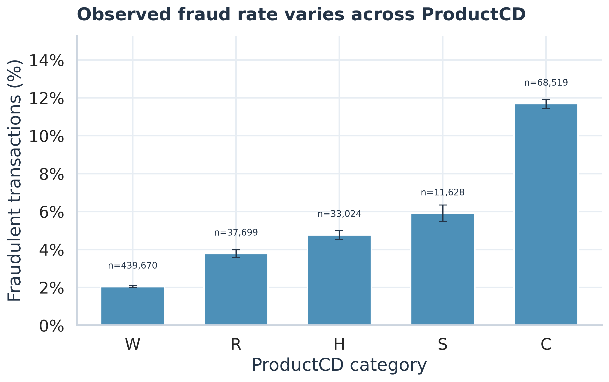
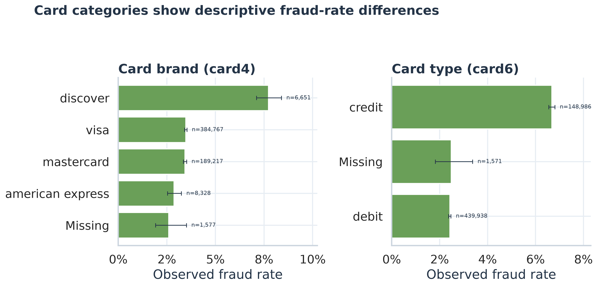

# Week 1 EDA findings

Input: `.\cleaned_data\train_cleaned.csv`. This analysis uses only the cleaned training table (590,540 rows, 434 columns). No test file was opened.

## Findings

1. The training set contains 590,540 transactions: 20,663 fraudulent (3.50%) and 569,877 legitimate (96.50%). This is a strongly imbalanced target distribution.
2. TransactionAmt is right-skewed: the overall median is 68.77, the mean is 135.03, and the 99th percentile is 1104.00. The plot uses a log10 amount axis so the long tail and dense low-value region are both visible.
3. Fraudulent transaction amount median is 75.00 versus 68.50 for legitimate transactions. This is a descriptive difference and does not establish a cause.
4. ProductCD category C has the highest observed fraud rate (11.69%, n=68,519); the largest category by volume is W (n=439,670). Rates are accompanied by Wilson 95% intervals and should be read with category sizes.
5. Average missingness is 84.5% across the 40 identity columns and 41.3% across the 392 transaction feature columns in the merged training table. Missingness includes transactions without a linked identity record.
6. Identity attributes are present for 11,318/20,663 fraudulent transactions (54.77%) and 132,915/569,877 legitimate transactions (23.32%), where presence means at least one joined identity field is nonmissing. This difference is descriptive only.
7. Among card4 categories with at least 1,000 transactions, discover has the highest observed fraud rate (7.73%, n=6,651).
8. Among card6 categories with at least 1,000 transactions, credit has the highest observed fraud rate (6.68%, n=148,986).

## Visuals

### 01 class distribution

The bars compare legitimate and fraudulent transaction counts and percentages. The imbalance matters because overall accuracy alone could hide poor fraud detection.

### 02 amount distribution

The two curves compare transaction amounts by target on a log10 scale. Dashed lines mark each class median; the scale makes the long tail easier to see.

### 03 missingness top20

The bars show the 20 columns with the largest missing percentages after the identity merge. This matters because absent identity information is common and should not be mistaken for a failed transaction row.

### 04 productcd fraud rate

The bars show the share of fraudulent rows within each ProductCD category. Error bars show Wilson 95% intervals, and labels give category sizes; rates are descriptive, not causal.

### 05 card category rates

The panels compare observed fraud rates by card brand and card type for categories with at least 1,000 rows. Rare categories remain in the CSV summary but are omitted from these charts for readability.
